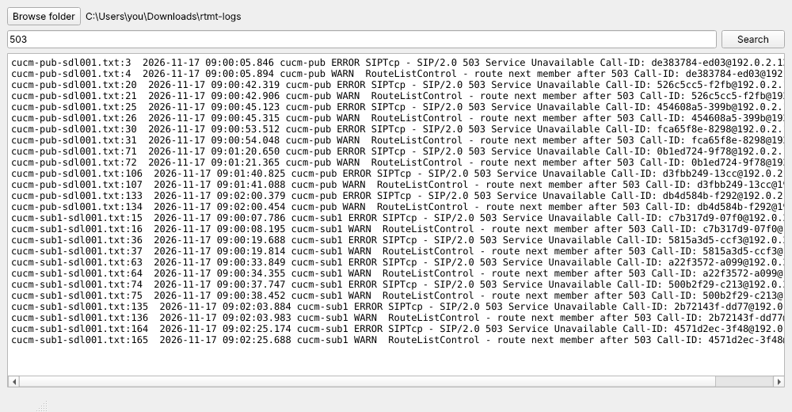

# RTMT Plus

RTMT Plus searches the log and trace files you download from Cisco Unified Communications Manager (CUCM) with Cisco's Real-Time Monitoring Tool (RTMT). Point it at a folder of logs, type what you're looking for (an error, a phone number, a SIP response, a call ID), and it lists every matching line with its file, line number and time.

It works on your computer only: it reads your files, never changes them, and sends nothing anywhere.



> **Status: early version.** Search works today. Correlating calls across servers and building timelines are planned (see [Roadmap](#roadmap)). RTMT Plus is not made or endorsed by Cisco.

## Windows: download the program

1. Open the **[latest release](https://github.com/jcliff01/RTMT-Plus/releases/latest)** and download **RTMT-Plus.exe**. (A release appears after the next change is merged; until then, use the steps below for any computer.)
2. Double-click it. If Windows shows **"Windows protected your PC"**, click **More info**, then **Run anyway**. The program isn't code-signed.
3. Click **Browse folder** and choose the folder with your downloaded logs.
4. Type what to search for and press **Enter**. It shows up to 1,000 matches. The window may pause for a few seconds on very large folders; that's normal for now.

## Any computer (Windows, macOS, Linux): install with Python

This gives you both the search window and the command line.

### 1. Install Python 3.10 or newer

| Computer | How |
| --- | --- |
| Windows | In PowerShell: `winget install Python.Python.3.12` |
| macOS | Download the installer from [python.org/downloads](https://www.python.org/downloads/) and run it |
| Linux (Ubuntu or Debian) | `sudo apt update && sudo apt install -y python3 python3-venv` |

Open a new terminal afterwards.

### 2. Install RTMT Plus

**Windows (PowerShell):**

```powershell
py -m venv $HOME\rtmt-plus
& $HOME\rtmt-plus\Scripts\python -m pip install "rtmt-plus[desktop] @ https://github.com/jcliff01/RTMT-Plus/archive/refs/heads/main.zip"
```

**macOS or Linux:**

```sh
python3 -m venv ~/rtmt-plus
~/rtmt-plus/bin/python -m pip install "rtmt-plus[desktop] @ https://github.com/jcliff01/RTMT-Plus/archive/refs/heads/main.zip"
```

This puts RTMT Plus in a folder of its own called `rtmt-plus` in your home folder. To remove it later, delete that folder.

### 3. Run it

| | Windows (PowerShell) | macOS or Linux |
| --- | --- | --- |
| Search window | `& $HOME\rtmt-plus\Scripts\rtmt-plus-desktop` | `~/rtmt-plus/bin/rtmt-plus-desktop` |
| Command line | `& $HOME\rtmt-plus\Scripts\rtmt-plus C:\logs -q "ERROR"` | `~/rtmt-plus/bin/rtmt-plus ~/logs -q "ERROR"` |

Replace `C:\logs` or `~/logs` with your log folder.

## Try it with the sample logs

No logs at hand? The folder [`examples/sample-logs`](examples/sample-logs) has two made-up CUCM-style log files (every number, address and call ID is invented). Download it with the rest of the repository (green **Code** button → **Download ZIP**), choose that folder with **Browse folder**, and search for `503`, `busy` or a call ID. The picture above is that search.

## Searching from the command line

```sh
rtmt-plus LOGS -q "ERROR"                                    # lines containing ERROR (any case)
rtmt-plus LOGS -q "SIP/2.0 503" --format csv > matches.csv   # save matches as a spreadsheet
rtmt-plus LOGS -q "Call-ID" --since 2026-11-17T09:00:00      # only lines from 9:00 AM on Nov 17
rtmt-plus LOGS -q "disconnect|timeout" --regex --limit 500   # either word, at most 500 results
```

Replace `rtmt-plus` with the full path from the table above, and `LOGS` with your folder.

| Option | What it does |
| --- | --- |
| `-q TEXT` | What to look for. Required. Ignores upper and lower case unless you add `--case-sensitive`. |
| `--regex` | Treat the text as a regular expression, so `disconnect\|timeout` means either word. |
| `--since` / `--until` | Only lines whose timestamp is in this range, written like `2026-11-17T09:00:00`. Lines without a timestamp are left out. |
| `--call-id ID` | Only lines that carry this call ID. |
| `--limit N` | Stop after N matches (default 1,000). |
| `--format` | `text` (default), `csv` for a spreadsheet, or `jsonl` for other programs. |

It searches `.log`, `.txt`, `.trace`, `.out` and `.gz` (compressed) files in the folder and all folders inside it.

## Troubleshooting

| What you see | What to do |
| --- | --- |
| `py`, `python3` or `rtmt-plus` "not recognized" / "command not found" | Open a new terminal after installing Python, and use the full path shown in step 3. |
| No matches, but you know the text is there | Check the folder; only the file types listed above are searched. Remove `--since`/`--until`: lines without a recognized timestamp are left out when you use them. |
| `Potentially unsafe regular expression` | That pattern could take a very long time. Simplify it, or search without `--regex`. |
| Times aren't recognized | It reads dates written like `2026-11-17 09:00:00`. Other CUCM formats aren't recognized yet. |
| The window needs PySide6 | Run step 2 again; the `[desktop]` part installs it. |

## Privacy

Logs can hold phone numbers, user names, IP addresses and call details. Only search logs you're authorized to use. Don't post real logs in GitHub issues: replace names, numbers and addresses first.

## Roadmap

1. **Search (now):** text and pattern search, time and call-ID filters, CSV and JSON export.
2. **Correlation:** follow one call across CUCM servers, rebuild SIP dialogs, save searches.
3. **Monitoring:** optional read-only connections to Cisco's supported monitoring interfaces.
4. **Diagnostics:** spot recurring problems and suggest causes, keeping data private.

## For developers

```sh
git clone https://github.com/jcliff01/RTMT-Plus.git && cd RTMT-Plus
python -m venv .venv
# Windows: .venv\Scripts\Activate.ps1    macOS/Linux: source .venv/bin/activate
python -m pip install -e ".[desktop,dev]"
python -m pytest
```

Tests run on Windows, macOS and Linux for every change. [docs/WINDOWS_BUILD.md](docs/WINDOWS_BUILD.md) shows how the Windows program is built.

## License

[MIT](LICENSE). Cisco, CUCM and RTMT are trademarks of their owners; RTMT Plus is an independent community project.
